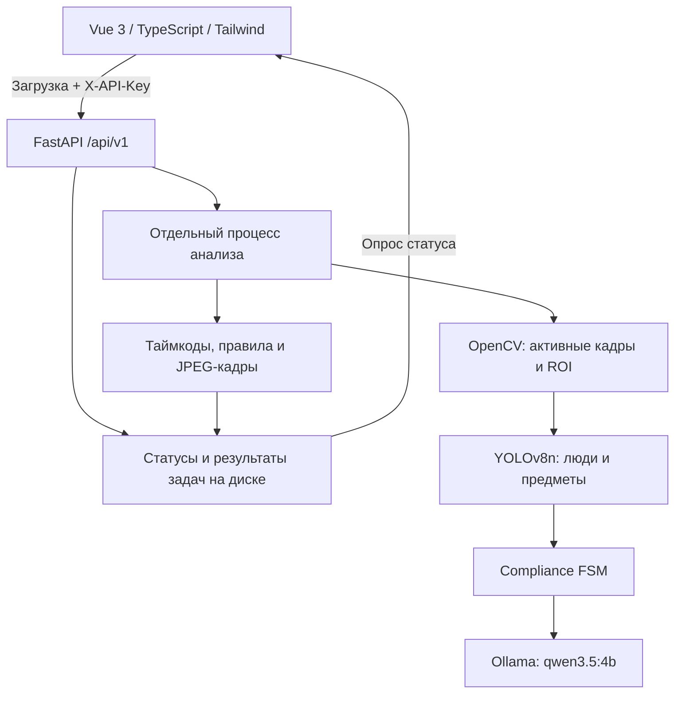

# Vizi

Vizi анализирует видеозаписи кассовых операций и показывает события, требующие внимания: тип, таймкод, описание, правило и кадры-доказательства. Анализ выполняется локально с помощью YOLO, OpenCV, сценарного автомата и мультимодальной модели в Ollama.

## Запуск

Из корня проекта с настроенным `.env`:

```powershell
docker compose up --build -d
```

Нужны Docker Desktop с Linux containers и Docker Compose v2. При первом запуске Compose загружает модель Ollama, собирает приложение, применяет migrations и запускает FastAPI вместе с веб-интерфейсом.

- Интерфейс: http://localhost:8000
- Swagger: http://localhost:8000/api/docs
- Проверка сервера: http://localhost:8000/api/health

В интерфейсе откройте настройки подключения, оставьте адрес `/api` и укажите значение `ANALYSIS_API_KEY` из своего `.env`. Затем загрузите видео и нажмите кнопку анализа. Интерфейс покажет статус обработки, итоговый результат и кадры событий.

Порт приложения задаёт `API_PORT`. Node.js и Python на хосте для Docker-запуска не нужны.

```powershell
docker compose ps -a
docker compose logs --tail 100 app model-init ollama
docker compose down
```

## Настройка

Для новой локальной копии:

```powershell
Copy-Item .env.example .env
```

Задайте собственный `ANALYSIS_API_KEY`. Секреты хранятся в локальном `.env`, который исключён из Git и Docker build context.

| Переменная | Назначение |
| --- | --- |
| `APP_NAME` | Название приложения, `Vizi` |
| `API_PORT` | Внешний порт Docker / порт локального backend, `8000` |
| `WEB_PORT` | Vite dev server, `5173` |
| `ANALYSIS_API_KEY` | Ключ для `X-API-Key` в API анализа и настройках интерфейса |
| `ANALYSIS_TIMEOUT_SECONDS` | Максимальное время работы процесса анализа, `280` секунд |
| `MAX_UPLOAD_MB` | Лимит загружаемого видео, `512` МБ в примере настроек |
| `AI_MODEL` | Модель Ollama, `qwen3.5:4b` |
| `AI_BASE_URL` | Локально `http://127.0.0.1:11434/v1`; Compose задаёт `http://ollama:11434/v1` |
| `AI_API_KEY` | Для локальной Ollama — техническое значение `ollama` |
| `AI_TIMEOUT_SECONDS` | Timeout одного обращения к модели, `280` секунд |
| `OLLAMA_MODELS_DIR` | Необязательный путь к существующему каталогу `.ollama`; иначе используется Docker volume |
| `DATABASE_URL` | По умолчанию `sqlite:///./data/app.db` |
| `ENABLE_AI` | Дополнительный маршрут `/api/ai/chat` |
| `ENABLE_AUTH`, `ENABLE_UPLOADS` | Дополнительные модули авторизации и файлового хранилища |
| `SECRET_KEY` | Секрет подписи JWT при включённом auth |

`ANALYSIS_API_KEY` защищает HTTP API приложения. Локальная Ollama использует отдельное соединение внутри Docker-сети. Ключи не помещаются в `VITE_*` и не включаются в сборку frontend.

Видео, статусы задач и результаты сохраняются в `backend/data/analysis/`, SQLite — в `backend/data/`. Веса Ollama хранятся в `OLLAMA_MODELS_DIR` либо в именованном volume `ollama_data`. Обычный `docker compose down` сохраняет данные.

## Архитектура



- **Frontend:** Vue 3, TypeScript, Vite 6, Tailwind CSS, Lucide.
- **Backend:** FastAPI, Pydantic, SQLAlchemy 2, Alembic.
- **Анализ:** OpenCV, Ultralytics YOLOv8n, адаптивная топология кассовой зоны, FSM и локальная VLM.
- **Docker:** `ollama` обслуживает модель, `model-init` загружает веса, `app` раздаёт UI и API на одном порту.

Анализ выполняется последовательно в отдельных процессах. Сервер принимает загрузку, возвращает идентификатор задачи и предоставляет результат для опроса. Лимит времени контролируется сервером. Завершённые результаты доступны после перезапуска.

## API

Все маршруты анализа принимают заголовок `X-API-Key`.

### Загрузка видео

`POST /api/v1/analyze` — `multipart/form-data`, поле `file`.

Поддерживаются MP4, MOV, AVI, MKV, WebM и M4V. Сервер проверяет размер и возможность декодирования видео. Ответ `202 Accepted`:

```json
{
  "job_id": "899d31b5eea24ac3b0b6bdc9e7b81351",
  "status": "queued",
  "filename": "cashier.mp4",
  "total_duration_sec": 30.0
}
```

### Статус и результат

`GET /api/v1/jobs/{job_id}`

Статусы: `queued` → `processing` → `done` / `failed`. Готовый результат содержит `verdict` (`violation` или `no_violation`), `violations`, время обработки и число проверенных сегментов. Каждое событие включает `type`, `timecode_sec`, `description`, `rule` и `evidence_frames` с JPEG в base64. При статусе `failed` поле `error` содержит сообщение.

Пример запроса из PowerShell (ключ вводится в текущей сессии):

```powershell
$apiKey = Read-Host 'ANALYSIS_API_KEY'
curl.exe -X POST http://localhost:8000/api/v1/analyze -H "X-API-Key: $apiKey" -F "file=@C:/Videos/cashier.mp4"
curl.exe http://localhost:8000/api/v1/jobs/JOB_ID -H "X-API-Key: $apiKey"
```

API также доступен через Swagger с кнопкой Authorize.

## Структура

```text
backend/
  app/features/analysis/   # HTTP API, хранение задач и процесс анализа
  app/features/ai/         # Общий анализатор, motion extraction, FSM, VLM
  app/models/             # Веса YOLOv8n
  app/core/               # Settings, база данных, обработка ошибок
  migrations/             # Alembic
  tests/                  # API, анализ видео, motion extraction, FSM
frontend/src/             # Интерфейс, API client, просмотр результатов
scripts/                  # Команды разработки и CLI-обработка видео
Dockerfile                # Frontend build + Python runtime
docker-compose.yml        # App + Ollama + загрузка модели
```

## Разработка

Нужны Node.js 20.19+ и Python 3.11+. Из корня:

```powershell
npm run setup
npm run dev
```

Vite: `http://localhost:5173`; FastAPI: `http://localhost:8000`. Vite проксирует `/api` в backend. Для локального анализа запустите Ollama и загрузите модель из `AI_MODEL`.

```powershell
npm run lint
npm run test
npm run build
```

CLI использует тот же анализатор, что и HTTP API:

```powershell
python scripts/detect_elements.py C:/Videos/cashier.mp4 --no-video
```